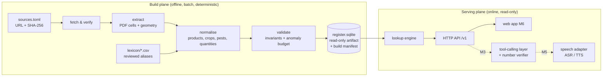

# High-level design: Pesticide label-claim check

Version 0.1 (2026-11-13), for review. Read with `requirements.md`. Decisions are recorded in `docs/adr/`.

## 1. The core idea in one sentence

**Facts come only from the official register. Software turns the register into a checked, versioned dataset, and answers questions by lookup.** Language models (M3+) only interpret the question and phrase the answer, and a verifier stops them from adding facts (ADR-003).

## 2. Two planes



| Plane | Runs | Inputs | Outputs | Failure policy |
|---|---|---|---|---|
| Build | When a new register edition appears (a few times a year), and in CI | PDFs (by hash), lexicon, code | `register.sqlite` + `build_manifest.json` + anomaly report | **Fail closed**: a hash mismatch, a broken invariant or an anomaly over budget means no artifact |
| Serve | Always | `register.sqlite` (read-only) | Answers with citations | Never writes to the register. Answers state the register date. |

Why two planes: the register changes rarely and must be correct. Building it once, checking it hard, and serving it read-only removes a whole class of runtime failures. It also makes every answer reproducible from a known artifact (ADR-001).

## 3. Components

| Component | Package (`src/labelclaim/…`) | Responsibility | Milestone |
|---|---|---|---|
| Source manifest and fetcher | `sources` | Download listed PDFs, verify SHA-256, cache by hash | M1 |
| PDF table extractor | `extract` | Pages → tables → rows → cells with bounding boxes. Map cells to logical columns by geometry (ADR-002). | M1 |
| Row assembler | `extract.assemble` | A state machine across pages: section → product → crop → use rows. Handles page breaks and merged crop cells. | M1 |
| Normaliser | `normalize` | Product headings → ingredients, concentration, formulation. Quantities. Crop and pest IDs through the lexicon (ADR-006). | M1 |
| Validator | `validate` | Invariants, provenance re-check, anomaly budget | M1 |
| Register store | `register` | Schema, deterministic SQLite writer, canonical dump, reader | M1 |
| Lookup engine | `lookup` | Name resolution, the matching rules, outcome selection (closed set), citations | M2 |
| HTTP API | `api` | FastAPI, versioned `/v1`, error envelope, input limits | M2 |
| Tool layer and verifier | `assistant` | The LLM may call only `lookup` and `ask_clarifying_question`. Every number in its reply must appear in the returned rows. | M3 |
| Evaluation | `evaluation` | Golden-set scoring, query suite, Kisan Call Centre harness | M1–M4 |
| Speech adapter | `speech` | ASR/TTS behind one interface (Bhashini vs self-hosted) | M5 |
| Web app | `web/` | Phone-first UI | M6 |

**Dependency rule:** `api` → `lookup` → `register`(reader). `extract`/`normalize`/`validate` → `register`(writer). Nothing in the serving plane imports the build plane, and this is enforced by a test on import edges.

## 4. Key flows

### 4.1 Build

1. `labelclaim build --sources data/sources.toml --lexicon data/lexicon --out build/`
2. For each source document:
   1. Fetch it (or read it from the cache) and verify its SHA-256.
   2. Detect sections from the heading text. The document's own index is wrong: it says combinations start on p. 53 (they start on p. 54) and fungicide combinations on p. 42 (they start on p. 45).
   3. Extract the tables in the agricultural sections and assemble use rows.
3. Normalise, then validate.
4. Write the SQLite file in a deterministic order, then write a canonical JSON dump and its hash into `build_manifest.json`.
5. Write `anomalies.json`. The build fails if the number of anomalies that are not on the reviewed allow-list exceeds the budget.

### 4.2 Lookup (M2)

```text
client --POST /v1/lookup {product, crop, pest?}--> api
api: validate input (size, charset) --> lookup.resolve(product), resolve(crop), resolve(pest)
  any unresolved/ambiguous  --> UNKNOWN_* / AMBIGUOUS + suggestions
lookup.match(product, crop, pest) over use_record
  rows found                 --> APPROVED + rows + citations
  product known, crop absent --> NOT_APPROVED_FOR_CROP + crops it is approved for
  crop ok, pest absent       --> NOT_APPROVED_FOR_PEST + pests it is approved for (and approved products for that crop+pest)
banned/restricted overlay    --> flag
api <-- answer {outcome, rows, citations, register_date, disclaimer}
```

## 5. Data (summary; the full schema is in L1 §7)

`source_document`, `product`, `ingredient`, `product_ingredient`, `crop` + `crop_alias`, `pest` + `pest_alias`, `use_record` (raw text plus parsed values plus provenance), `restriction` (banned / restricted), `build_info`.

Approximate size from the data spike (heuristic counts):
- Insecticides (agricultural): about 360 product headings and 1,200 use rows.
- Fungicides: about 290 product headings and 1,050 use rows.
- About 140 distinct crop strings before normalisation.

## 6. Deployment

| Stage | Where | How |
|---|---|---|
| M1–M4 | This machine (`ENV-NATIVE-1`) | `uv run`, local SQLite file |
| M6 pilot | One small container (any host; AWS is optional here because the textbook project carries the AWS work) | Image with the API + static web app + `register.sqlite` baked in; read-only filesystem |

The register artifact is baked into the image, so a deploy is atomic: the code and the data version move together.

## 7. Cross-cutting concerns

- **Observability:** structured JSON logs with a request ID. Every answer logs `{outcome, register_build_hash, latency_ms}`, and never the user's free text unless consent is given (pilot).
- **Errors:** one error envelope `{error: {code, message, request_id}}` (the same pattern as Porter's).
- **Configuration:** environment variables with a typed settings object. No secrets in M1–M2.
- **Versioning:** the API is `/v1`. The register carries `register_date` and a `build_hash`.
- **Security:** see `threat_model.md`.

## 8. Decisions (ADRs)

| ADR | Decision |
|---|---|
| [001](adr/0001-register-as-build-artifact.md) | The register is a read-only SQLite build artifact, not a live database |
| [002](adr/0002-geometry-based-table-extraction.md) | Deterministic, geometry-based table extraction. No LLM extraction. |
| [003](adr/0003-facts-only-from-register.md) | Facts come only from the register. Models interpret and phrase, and a verifier checks every number. |
| [004](adr/0004-keep-raw-official-text.md) | Keep and show the raw official text next to every parsed value |
| [005](adr/0005-python-fastapi-uv.md) | Python 3.12, FastAPI, uv with `exclude-newer`, ruff, mypy strict |
| [006](adr/0006-reviewed-lexicon.md) | Names are resolved through a reviewed lexicon. Fuzzy matching only suggests. |
