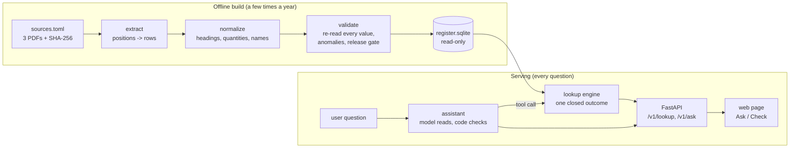

# How it works, stage by stage

Each stage is described the same way:
- **what** it does;
- **why** it is built that way;
- **where** the code is;
- **what proves it**: a test or a measurement.

If an interviewer points at any box in the diagram, you should be able to answer from the matching section.

**Two planes.** The *build* is slow, careful and offline. *Serving* is fast, and read-only on a file the build produced. This one decision (ADR-001) explains a lot:
- no database server;
- no way for a request to change the data;
- a release is a file with a hash.

---

## 1. Sources: know exactly which document you read

- **What:** `data/sources.toml` lists the three official PDFs: the insecticide and fungicide registers (as on 30.09.2026) and the banned and restricted list (31.10.2026). Each entry has its URL and **SHA-256**. `sources.py` downloads each file to a cache and refuses it if the hash differs.
- **Why:** every answer cites "page 18 of this exact file". If the government replaces the PDF, the build must stop rather than quietly cite pages that moved.
- **Proof:** `tests/test_sources.py` (a hash mismatch stops the build).

## 2. Extraction: tables by position, not by text (the hardest part)

- **What:** `extract/pages.py` reads the words and ruled lines with pdfplumber. `extract/geometry.py` turns the column edges of each **product block** into bands, and puts each cell in the band its *centre* falls in. `extract/assemble.py` builds use rows:
  - it carries merged cells ("same as above") down;
  - it joins values that continue across a page break;
  - it marks a value spanning two columns as belonging to the leftmost one.
- **Why position, not text:**
  - rows have anywhere from 4 to 15 cells for 6 real columns;
  - one table can hold two products with *different* column widths (insecticide p. 8);
  - a cell can span two columns (fungicide p. 20).

  Text order alone would put a crop into the pest column.
- **The rule that saves you:** an unknown layout becomes an **anomaly**, never a guess. The rodenticide table on p. 7 has a different shape, so it is flagged (`UNMAPPED_TABLE`) and listed, with a reason, in `data/anomaly_allowlist.toml`.
- **Proof:**
  - `tests/test_golden_pages.py`: hard real pages (p. 8, 20, 38/39, 51, 60, 67/68, 76), with expected values typed from page *images*, not from the extractor's output;
  - `tests/test_extract.py`;
  - E1: 120 random rows labelled from images, then a fresh 60 (E1b), scoring 99.36 % of fields.

## 3. Provenance: every value can be checked against its box

- **What:** every stored value keeps its page and bounding box. On every build, `validate.py` uses `Reextractor` (in `pages.py`) to **re-read each value from its box** and compares the two (invariant I3).
- **Why:** it turns "I think the extraction is right" into "every one of about 14,000 values was re-read from the PDF in this build".
- **Proof:** `tests/test_register_validate.py` includes a planted mismatch that must be caught. Mutant M5 removes the re-check, and that test catches it.

## 4. Normalisation: from printed text to things you can match

- **Product headings** (`normalize/headings.py`): "Emamectin benzoate 05 % SG" becomes the ingredient emamectin benzoate, 5 %, formulation SG. Combinations ("A 10% + B 50% WDG") match as **sets** of ingredients.
- **Quantities** (`normalize/quantities.py`): doses, dilutions and waiting periods are parsed where the text allows. **The raw text is always kept** (ADR-004), because the user is shown what the register *printed*.
- **Names** (`normalize/lexicon.py`, `pests.py`, `ingredients.py`, `generic.py`):
  - `key()` and `match_key()` decide when two spellings are the same name ("White fly", "Whiteflies" and "whitefly" are one);
  - ingredient spelling families ("sulphur" = "sulfur");
  - **general terms** ("blight", "gourd") that stand for several specific pests or crops.
- **Why a reviewed lexicon, not "let the LLM figure it out"** (ADR-006): a wrong merge silently turns one pest into another, and in this domain that becomes a wrong approval. Every alias row is signed by its reviewer. A release build **refuses to run** while any row is unreviewed.
- **Corrections** (`corrections.py`, `data/corrections.toml`, ADR-007): 11 extraction errors found by audit are fixed through a reviewed file, never by editing the database.

## 5. The register file

- **What:** `build.py` writes `register.sqlite` (`register/writer.py`). It holds:
  - products, ingredients and use rows, with crops and pests;
  - aliases and restrictions;
  - `build_info`, with the build hash and source hashes.

  The same inputs give a **byte-identical** dump (NFR-2).
- **Release:** `python -m labelclaim.build run --release` fails if any lexicon row is unreviewed or any anomaly is not on the allow-list. The current release is `285c851f…`.

## 6. The lookup engine: one question, one closed answer

- **What:** `lookup/engine.py`. `Engine.lookup(Query)` takes a product (or ingredient), a crop and an optional pest, and returns **exactly one outcome**:

  | Outcome | Meaning |
  |---|---|
  | `APPROVED` | the rows that match everything asked |
  | `NOT_APPROVED_FOR_CROP` | no use on this crop; shows the crops it *is* approved on, and alternatives |
  | `NOT_APPROVED_FOR_PEST` | registered on the crop, not for this pest; shows what is approved for this crop and pest |
  | `UNKNOWN_PRODUCT` / `UNKNOWN_CROP` / `UNKNOWN_PEST` | a name the register does not know, with "did you mean" suggestions (never applied silently) |
  | `AMBIGUOUS` | a general name with different answers per member, or a near name to confirm |

  A separate `conflict` flag says that a ban or restriction names this crop, or bans the ingredient.
- **Order of checks** (`_on_crop`):
  1. product;
  2. crop (exact, general or unknown);
  3. pest;
  4. the product's rows on the crop.

  This order is what makes the outcome deterministic.
- **The pilot fixes that live here:**
  - **Near names** (`_near_names`): asking about "tikka" when the row says "Tikka leaf spot" gives AMBIGUOUS with that option, not a false "not listed".
  - **Alternatives** (`_uses_for`): the asked product's own ingredients come first, ranked before the cap of 20.
  - **Kannada case endings** (`Names.kannada_stem`): "aalugaddeyalli" is read as aalugadde.
- **Speed:** p50 0.12 ms, p95 0.16 ms in-process. Names load into memory once; each lookup is a few indexed SQLite reads.
- **Proof:** `tests/test_lookup.py`; the E3 suites (150/150, 31/31, 59/60), labelled from page descriptions before the engine existed.

## 7. The API

- **What:** `api/app.py` (FastAPI, Pydantic v2, `api/schemas.py`):

  | Route | Purpose |
  |---|---|
  | `POST /v1/lookup` | the structured question |
  | `POST /v1/ask` | the plain-words question |
  | `GET /v1/crops`, `/v1/pests`, `/v1/products` | name suggestions |
  | `GET /v1/register` | the register dates |
  | `GET /healthz` | health |
  | `/v1/pilot`, `/v1/feedback` | private tests |

- **Engineering details worth knowing:**
  - **One error envelope** for every failure. A lookup that finds nothing is a 200 with an outcome, not a 404.
  - **The access log** records method, path, status, latency and outcome, and **never the question text** (NFR-5).
  - **One engine per worker thread:** SQLite connections are not shared across threads.
  - **Limits:** a per-client token bucket; a **daily cap** on `/v1/ask` (800, below Groq's free 1,000 a day).
  - **Security headers:** a CSP of `default-src 'self'`, except on `/docs`.
  - The committed `openapi.json` is checked against the code by a test.

## 8. The assistant: the model reads, the code checks (`assistant/`)

This is the AI-engineering core. The flow in `loop.py`:

1. **Understand.** The model gets the question and two tools: `lookup(product, ingredient, crop, pest)` and `ask_clarifying_question(missing)`. Earlier turns of a short conversation can be sent too (`history`). An "assistant" turn is kept only if it could be one of the app's own questions, so a client cannot plant facts.
2. **Check the model's reading against the user's own words** (`_understand`, `_with_users_crop`, `_never_wider`, `_slots_from_question`). Each guard is deterministic and came from a measured failure:

   | Guard | The failure it stops (and where it was found) |
   |---|---|
   | Fix 3: the formulation the user typed | the model dropped "5% SG" and the lookup ran at ingredient level (E3n) |
   | The user's product text | the model mis-copied "0.4%" as "0.5%" (E3n-b) |
   | **Fix A:** the typed crop wins | the model translated "bende" (okra) to **brinjal**, so the approval was for the wrong crop (E3n-c) |
   | **A2:** extra words in the crop slot | "kabbu hula ge" was cut to "kabbu", which dropped the pest and widened the answer (E3n-e) |
   | **A3:** the answer is never wider than the question | the model left the pest out, so a pest question became a crop-wide approval (E3n-f) |
   | **Fix B:** read before asking | the model asked "which crop?" when the question named one ("godhi ge …") (E3n-d) |
   | The empty crop | an empty crop used to fail over; now it is a clarification (E3n-e) |

3. **Look up.** The engine decides. The **headline is a template** on its outcome (`templates.py`), so model text can never change the answer the user reads first. A crop-specific ban leads the headline ("Banned on this crop: …").
4. **Phrase, then verify.** The model writes a short reply from the tool result. `verify.py` then checks it:
   - every number must appear in the cited rows (digits, ranges, fractions, number words, Kannada digits);
   - advice wording ("recommended", "safe") is blocked;
   - **fix E:** the reply may not equate the user's crop with another, as in "maavu (wheat)".

   If anything fails, the reply is replaced by the rows **as printed**.
5. **Providers** (`providers.py`, ADR-008): Groq `gpt-oss-120b` first, then the first Gemini model that answers, with a cool-down on rate limits. A model that declines to call a tool gets an out-of-scope reply, not a 503. Keys come from a mode-600 file or the environment (`secrets.py`) and are never logged.
6. **Language:** the page sends `lang`, and the reply is in English or Kannada as chosen.

- **Proof:**
  - `tests/test_assistant.py` uses a scripted fake model, so there is no network in tests;
  - the eight E3n suites, scored from the recorded answers;
  - the replays in `evaluation/e3nd/`, `e3ne/` and `e3nf/`.

## 9. The web page (`web/`)

- **What:** plain HTML, CSS and two script modules (about 17 KB, no build step, no npm):
  - **Ask** and **Check** tabs, English and Kannada labels;
  - the answer card shows the headline, the reply, each register row **as printed** with its page and a link to the official PDF page, the alternatives (all of them), and the disclaimer.
- **Why so plain:** the safety lives in the engine and the verifier, so the page's job is to show the answer without changing it. API text always goes in with `textContent`, never as HTML, and the CSP forbids inline scripts.
- **Proof:** `tests/test_web.py`, plus browser checks at 375 px, recorded in L4 §8–9.

## 10. Private tests that record what happens

`--pilot-log FILE` turns on recording, off by default:
- each question, answer and 👍/👎 is appended as a JSON line;
- no IP or headers are kept, and the file is created with mode 600;
- the page shows testers a notice.

The first test (the user and ChatGPT, 25 questions) found six real problems. All six were fixed in safety order (`reports/pilot/2026-11-18_private_test.md`).

## 11. Evaluation and quality tooling

| Tool | What it does |
|---|---|
| `tools/ci.sh` | ruff, format check, mypy strict, pytest with branch coverage (≥ 90 % on extract, normalize and lookup) |
| `tools/e1.py` | the extraction golden set |
| `tools/e3.py` | the engine suites |
| `tools/e3n.py` | the live language-layer suites: run (records bodies, never headers) and score (offline, from the records) |
| `tools/mutants.py` | 89 deliberate bugs. Each must make a test fail. A test set must pass *unmutated* first, and a mutant that no longer applies fails the run |
| The rule behind every number | the suite is committed **before** the fix; predictions are written **before** the run; wrong predictions are reported as wrong |
